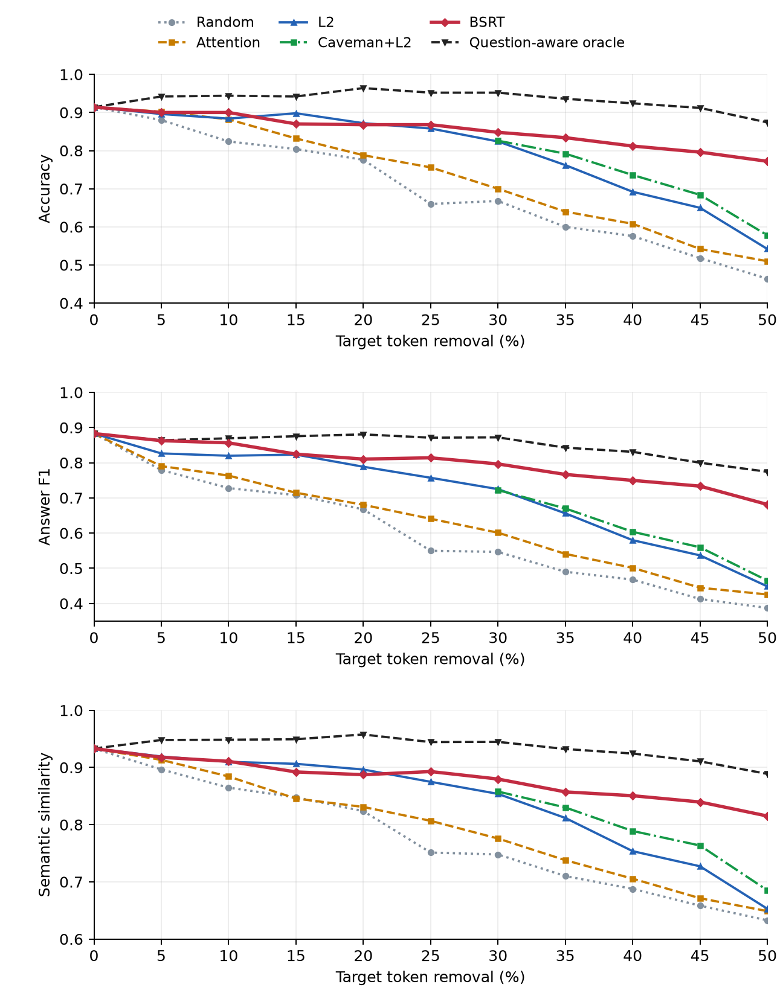
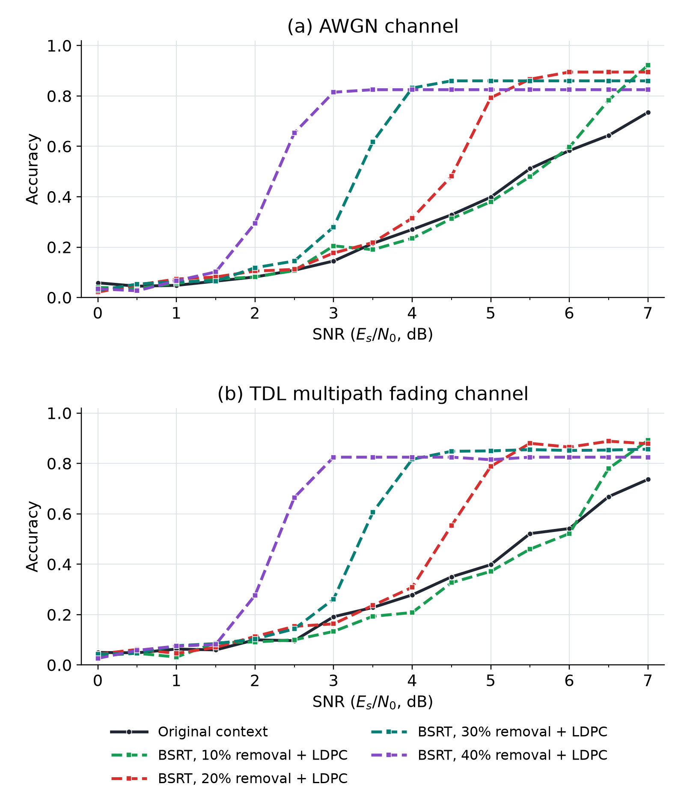
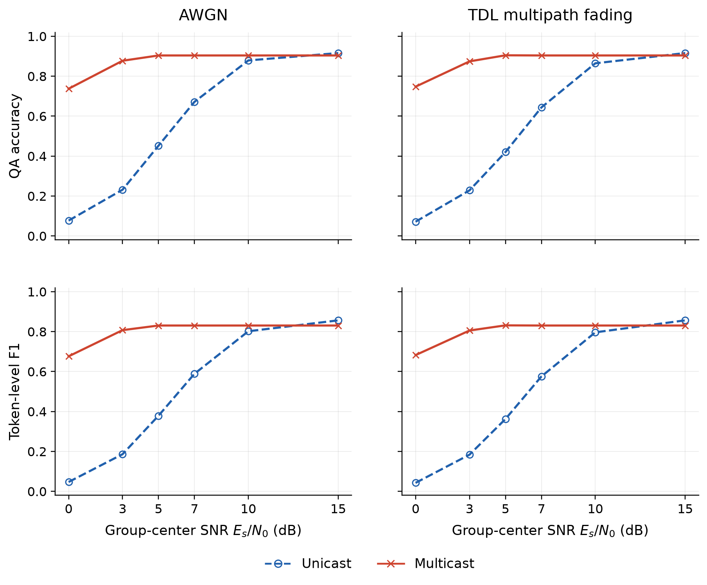
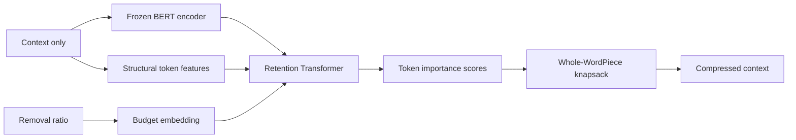

# BSRT Semantic Compression

**Budget-Conditioned Semantic Retention Transformer for question-independent text compression**

This repository is the reproducible portfolio release of my master's thesis on token-level semantic importance for communication systems. It trains a compact Transformer to score which WordPiece groups should survive a requested token-removal budget. At deployment, the compressor receives only a context and a target removal ratio. It never receives the downstream question.

The released model improves extractive QA retention over non-contextual and attention-based selectors at aggressive compression levels.

| Removed tokens | BSRT F1 | L2 F1 | Attention F1 | BSRT accuracy | Semantic similarity |
|---:|---:|---:|---:|---:|---:|
| 40% | **0.750** | 0.580 | 0.501 | **0.812** | **0.851** |
| 50% | **0.681** | 0.449 | 0.426 | **0.772** | **0.815** |

At 40% removal, the context-cluster bootstrap estimate for BSRT minus L2 is **+0.170 mean F1**, with a 95% interval of **[0.113, 0.229]**.



## Equal-budget LDPC results

The communication study reinvests bits saved by semantic compression into rate-matched LDPC. Every coded frame uses exactly the same number of transmitted bits and QPSK symbols as the uncoded original-token baseline for that context.

| AWGN SNR | Best tested LDPC setting | LDPC accuracy | Uncoded original | Gain |
|---:|---:|---:|---:|---:|
| 3 dB | 40% removal | **0.815** | 0.145 | **+0.670** |
| 5 dB | 30% removal | **0.860** | 0.398 | **+0.462** |
| 7 dB | 10% removal | **0.922** | 0.735 | **+0.187** |

These are descriptive best points among the tested settings, not an adaptive selection policy. At 0 dB every coded setting underperformed the uncoded original, which is reported rather than hidden. The complete 9,600-outcome AWGN experiment, context-clustered intervals, BER audit, fading and packet-loss extensions, and the 90,000-outcome half-decibel sweep are in [`results/ldpc_equal_budget`](results/ldpc_equal_budget).



## Multi-receiver unicast versus multicast

The end-to-end multi-receiver study compares individually task-compressed Unicast with task-aligned Multicast at the same aggregate wire budget. Multicast avoids duplicate source messages inside aligned receiver clusters and spends the saved capacity on LDPC and repetition.

The final paired analysis contains 416 receivers from 30 contexts and 109 non-singleton clusters. Both strategies use 524,268 bits per channel, SNR, and seed condition.

| Channel and group-center SNR | Unicast accuracy | Multicast accuracy | Gain |
|---|---:|---:|---:|
| AWGN, 3 dB | 0.232 | **0.877** | **+0.646** |
| AWGN, 5 dB | 0.452 | **0.904** | **+0.452** |
| TDL fading, 3 dB | 0.228 | **0.874** | **+0.646** |
| TDL fading, 5 dB | 0.420 | **0.905** | **+0.485** |
| AWGN, 15 dB | **0.916** | 0.904 | -0.012 |

Multicast reaches zero observed residual information BER from 5 dB in AWGN and 7 dB in the tested TDL setting. At 15 dB, Unicast retains a small advantage because its clean representation is tailored to each receiver. The experiment is answer-supervised and task-aware, so it is presented as a reference communication study rather than the deployable question-independent BSRT policy.



Full metrics, paired context-bootstrap intervals, verification records, the complete 500-question analysis, and the exact method boundary are in [`results/unicast_multicast`](results/unicast_multicast).

## What I built

- A budget-conditioned, two-layer Transformer retention head in PyTorch
- Frozen contextual embeddings from `deepset/bert-base-cased-squad2`
- Eight structural token features plus learned position and budget embeddings
- Exact dynamic-programming selection of whole WordPiece groups under the token budget
- A staged learning pipeline with answer-span pretraining, offline mask search, reward-weighted distillation, and validation-based model selection
- Paired evaluation across ten compression levels with QA F1, exact-match accuracy, semantic similarity, timing, ablations, and context-cluster bootstrap intervals
- Communication extensions covering QPSK, AWGN and TDL channels, packet erasures, and rate-matched LDPC under a fixed bit budget
- A verified equal-budget LDPC study with BER checks, context-clustered uncertainty, fading, and packet-loss extensions
- A task-aligned Unicast versus Multicast system with equal aggregate wire budgets, receiver clustering, LDPC, and repetition
- Exploratory PCA semantic-basis compression and receiver-alignment studies

## Architecture



The selection step keeps subword groups intact, preserves their original order, and reconstructs text from original character spans. The final public interface is deliberately small:

```python
compressed = model.compress(context, removal_ratio=0.40)
```

## Quick start

Python 3.10 or newer is recommended.

```bash
git clone https://github.com/mejrissimeh-bit/BSRT.git
cd BSRT
python -m venv .venv
python -m pip install -e .
python examples/compress.py
```

The first demo run downloads the frozen QA encoder from Hugging Face. The trained BSRT head is included as a safe, portable Safetensors file in `checkpoints/`.

Run the offline core and artifact tests with:

```bash
python -m pip install -e ".[dev]"
pytest -q
```

## Repository map

```text
bsrt_neural_compression/   Core model, training, search, evaluation, ablations
checkpoints/               Released BSRT-A0 head and portable configuration
experiments/communication/ QPSK, channel, token-ID, and LDPC components
experiments/pca_basis/     PCA semantic-basis experiments
experiments/multi_receiver Receiver-specific gradient-alignment study
task_aligned_multicast_500 End-to-end Unicast versus Multicast experiment
multicast_coding_budget/   Equal-budget channel coding and frame allocation
semantic_multicast/        Multicast allocation and selection components
results/ldpc_equal_budget/ LDPC metrics, audits, reports, and figures
results/unicast_multicast/ Paired Unicast and Multicast results and verification
results/                   BSRT metrics, reports, and thesis figures
tests/                     Fast tests that require no dataset or model download
docs/                      Method and reproducibility notes
```

## Evaluation protocol

The main study uses SQuAD 2.0 and the extractive QA model `deepset/bert-base-cased-squad2`. Contexts were split at article level to prevent article overlap between training and validation. Checkpoints were selected by validation F1. The final comparison archive contains 500 QA examples evaluated at removal levels from 5% to 50%.

The historical 500-example cohort was inspected repeatedly during thesis development. It is therefore a fixed comparison cohort, not a pristine discovery test set. That limitation is stated explicitly to keep the evidence honest. A production follow-up should add a newly locked external test set and report multiple training seeds.

SQuAD 2.0 combines answerable and unanswerable questions and is available under CC BY-SA 4.0. Dataset records are not redistributed in this repository. See the [official SQuAD page](https://rajpurkar.github.io/SQuAD-explorer/) and the [QA model card](https://huggingface.co/deepset/bert-base-cased-squad2).

## Reproducibility and safety

- The public checkpoint contains tensors only and loads through Safetensors
- Aggregate metrics and figures are included, while caches, raw dataset copies, and local paths are excluded
- Headline metrics are checked against the archived CSV during continuous integration
- Random seeds, model dimensions, provenance hashes, and selection rules are documented
- The legacy `.pt` loader remains for trusted local research checkpoints only

See [docs/reproducibility.md](docs/reproducibility.md) for provenance and [docs/bsrt_method.md](docs/bsrt_method.md) for the training design.

## Limitations

- The semantic objective is measured through one English extractive-QA model and dataset
- The frozen encoder is comparatively large even though the trainable retention head is compact
- Text reconstruction can be telegraphic at high removal ratios
- Results are from one main training seed
- The communication and multi-receiver studies are research extensions, not a deployed protocol stack

## Author

**Mehdi Mejrissi**

Master's thesis project in machine learning, semantic communication, reproducible evaluation, and PyTorch model development.

## License

Code is released under the MIT License. SQuAD and the pretrained QA model retain their own licenses and terms.
